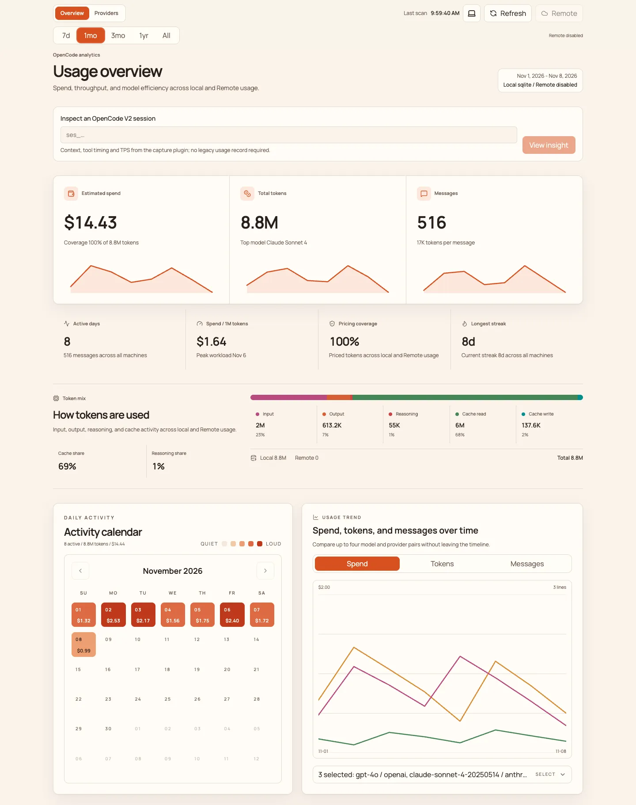
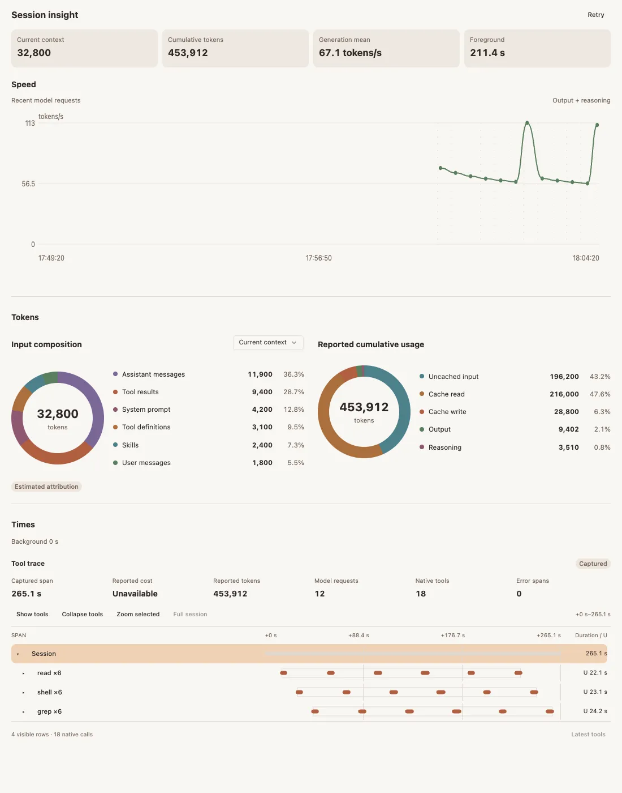

# OpenCode Insight

[](https://nodejs.org)
[](https://pnpm.io)

Local-first usage analytics and session insight for OpenCode.

- **Dashboard:** explore token usage, estimated cost, activity trends, and model/provider breakdowns. Drill into sessions and message/tool timelines, query usage from the CLI, and optionally sync aggregates across machines. Reads local OpenCode usage and Codex transcripts.
- **OpenCode + OpenChamber Insight:** an OpenCode V2 capture plugin and an OpenChamber panel for generation speed, context-source estimates, reported token usage, and tool timing. The panel works without the dashboard; the dashboard can also display V2 session insight.





Screenshots use synthetic data. The Insight image is a standalone preview of the actual panel, not the OpenChamber application shell. Source estimates are not billing measurements, and capture begins when the plugin loads.

# Usage

## Dashboard

Requires **Node.js 24+** and **pnpm 10+**.

```bash
git clone https://github.com/ChangeHow/opencode-insight.git
cd opencode-insight
pnpm install
cp .env.example .env.local
```

Set `OPENCODE_DATA_DIR` in `.env.local` to your OpenCode data directory (containing `opencode.db` or legacy `storage/`). Codex transcripts are read from `CODEX_HOME`, defaulting to `~/.codex`.

```bash
pnpm build
node scripts/opendash.mjs server
```

Open [localhost:8787](http://127.0.0.1:8787). Keep the default loopback binding: the dashboard has **no authentication** and can display private session content.

```bash
node scripts/opendash.mjs summary --range month
node scripts/opendash.mjs models --json
node scripts/opendash.mjs stop
```

For live V2 session metrics, install the capture plugin below, then use **Inspect an OpenCode V2 session** on the overview. Optional multi-machine sync is documented in [Connect another machine](ADD_MACHINE.md).

## OpenCode + OpenChamber plugins

Requires **Node.js 24+**, **OpenCode 2.0.26** (or a compatible V2 plugin contract), and **OpenChamber 2.5.0+** for the panel. Both plugins ship in `@changehow/oc-insight` starting with **1.1.0**.

Add the package to `plugins` in your global `~/.config/opencode/opencode.jsonc` or project-local `opencode.jsonc`, preserving existing entries:

```jsonc
{
  "$schema": "https://opencode.ai/config.json",
  "plugins": ["@changehow/oc-insight"],
}
```

OpenCode installs and loads the capture plugin itself. To install the OpenChamber panel:

```bash
npm install -g @changehow/oc-insight@latest
opendash extension-path openchamber
```

In OpenChamber, open **Settings → Extensions → Add**, select the printed `openchamber/` folder, and approve its local-process capability. Open **Insight** on the rail and select an OpenCode session.

OpenCode must already be running with the capture plugin loaded. Insight never starts or restarts it. See the [Insight guide](docs/v2-insight.md) for source builds, remote connections, upgrades, and measurement limits.
